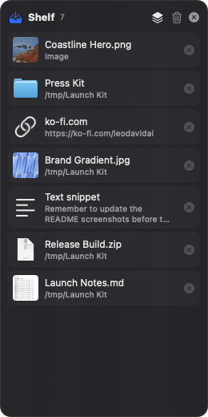
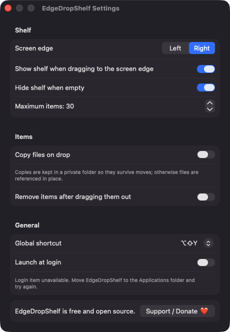
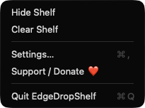

# EdgeDropShelf

**🌐 Website:** [turhe123.github.io/edge-drop-shelf](https://turhe123.github.io/edge-drop-shelf/)

A temporary drag and drop shelf that floats at the screen edge and holds files while you move between apps.

> 🆓 A free, open-source **Yoink alternative** for macOS 14+. Native Swift, no accounts, no subscriptions, MIT licensed.


## Why

EdgeDropShelf is a free, open-source, 100% native, backend-free alternative to paid utilities in the *Menu Bar Utility* category. It was inspired by Yoink ($8.99 one-time), a well-loved tool that popularized the edge-of-screen shelf idea. EdgeDropShelf is a clean-room implementation with its own design. It uses no network, no accounts and no third-party packages.

## Features

- **Menu bar app, no Dock icon.** The menu offers Show/Hide Shelf, Clear Shelf, Settings, Support and Quit.
- **Floating shelf panel.** A borderless, non-activating panel that slides in from the left or right edge of the screen under your cursor. It floats above other windows, on all Spaces and over full-screen apps.
- **Accepts files, images, text and web links.** Drop them on the shelf and each one gets a row with a thumbnail or icon, a name and a remove button. Text and links are previewed truncated.
- **Drag items back out** to any app, one at a time or all at once with the "Drag all items" handle.
- **Edge-drag reveal.** The shelf appears when you drag something to the chosen screen edge. You can turn this off in Settings.
- **Global hotkey** to toggle the shelf. Choose from ⌥⇧Y (default), ⌃⌥Y, ⌘⇧Y, ⌃⌥Space or none.
- **Reference or copy.** Files are referenced in place by default (with bookmarks that survive relaunch). Optionally copy them into a private folder in Application Support so they survive moves. Dropped images are saved there as PNGs.
- **Housekeeping options.** Hide when empty, remove items after dragging them out, and a maximum item count (5–200, default 30).
- **Safe handling of edge cases.** Duplicate drops are ignored. Files that were moved or deleted show as "Missing" and can only be removed. Drops are processed off the main thread with a progress indicator. Disk-full and copy failures show an alert. Clearing a shelf that holds private copies asks for confirmation first.
- **Quick Look thumbnails** with a fallback to Finder icons.
- **Persistent.** Shelf contents are restored on relaunch.
- **Launch at login** via `SMAppService`, with its status shown in Settings.

## Screenshots

<p align="center"></p>

<p align="center"><em>The floating shelf at the screen edge holding images, a folder, a web link, a text snippet and files, each ready to drag out to any app.</em></p>

<p align="center"></p>

<p align="center"><em>Settings let you choose the screen edge, edge-drag reveal, copy-on-drop, the global shortcut and launch at login.</em></p>

<p align="center"></p>

<p align="center"><em>The menu bar menu shows or hides the shelf, clears it, and opens Settings or the Support page.</em></p>

## Install

1. Download `EdgeDropShelf-macOS.zip` from the [latest release](https://github.com/turhe123/edge-drop-shelf/releases/latest).
2. Unzip it and move `EdgeDropShelf.app` to `/Applications`.
3. The app is open source and not notarized, so clear the quarantine flag:

   ```bash
   xattr -cr /Applications/EdgeDropShelf.app
   ```

4. Right-click the app and choose **Open** the first time you launch it.

## Build from source

Requires macOS 14+ and Xcode with Swift 5.9 or later.

```bash
brew install xcodegen
xcodegen generate
xcodebuild -project EdgeDropShelf.xcodeproj -scheme EdgeDropShelf -configuration Release -derivedDataPath ./build build
```

The app is built at `build/Build/Products/Release/EdgeDropShelf.app`.

## Permissions

EdgeDropShelf requests **no special system permissions**. It does not ask for Accessibility, Screen Recording or Microphone access. Here is what it does use:

- **Global hotkey:** registered with Carbon `RegisterEventHotKey`, which needs no permission.
- **Edge-drag detection:** uses a global mouse-event monitor to see when a drag reaches the screen edge. It only reads the cursor position and whether the drag pasteboard changed, and it never reads key presses. If this doesn't work on your system, use the hotkey or menu instead.
- **Login Items:** if you enable "Launch at login", macOS may ask you to approve it in System Settings › General › Login Items.
- **Files:** the app only reads the files you drop on it. Private copies and the shelf's metadata live in `~/Library/Application Support/EdgeDropShelf`.

## Support ❤️

EdgeDropShelf is free and always will be. If it saves you time, you can support its development:

[Support Or (Leo) Davidai ❤️ on Ko-fi](https://ko-fi.com/leodavidai)

## More free Mac apps

EdgeDropShelf is one of [60 free, open-source Mac utilities](https://github.com/turhe123/mac-apps) built the same way: native Swift, no accounts, no telemetry. Browse the full gallery at [turhe123.github.io/mac-apps](https://turhe123.github.io/mac-apps/).

## License

MIT © Or Davidai Bachar
